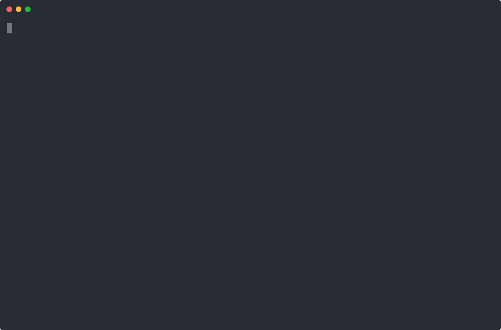

# Demo: same size, same price, 2.4× the speed for GILty

[GILty](https://github.com/SpareCores/GILty) is a Python app that cannot use
more than one CPU: it learns *Moby-Dick* as a Markov chain and babbles in its
style, one dependent hash lookup after the other, so only a faster core and a
faster cache make it faster. On a live EKS Auto Mode cluster, the demo:

1. runs GILty on an instance type picked by hand, `r5a.large` (AMD EPYC 7571,
   2 vCPUs, 16 GiB), through a plain Karpenter NodePool, and shows its speed
   in its logs;
2. installs sc-karpenter-nodepool v0.1.1 and creates an `SCNodePool` with the
   same constraints: at least 2 vCPUs and 16 GiB, at most 10% more than the
   `r5a.large` ($0.1392/h with the Auto Mode fee), no burstable or flex types,
   and instance families ranked by PassMark's single-threaded score (the
   benchmark that tracked GILty best in our measurements), keeping those
   within 10% of the fastest. It selects `r6a.large` (AMD EPYC 7R13, the same
   2 vCPUs and 16 GiB, $0.1270/h);
3. runs a second, identical GILty on that pool and streams both logs side by
   side, every five seconds: about 1.9–2.0 million words/s on the
   `r5a.large`, 4.5–4.8 million on the `r6a.large`, **about 2.4× faster on an
   instance of the same size and price**.

Both pods run the same image (GILty 0.2.1, CPython from
python-build-standalone) and name their instance type from the node's label.
Speeds vary by about 20% between hosts of the same instance type; across our
runs this pair measured 1.6× to 3× apart.

Everything was recorded live (2026-10-14, us-east-2); only the typing is
synthetic, and waits for nodes are time-lapsed. The two log streams play in
real time.

## Watching it

- **Web**: `index.html` (asciinema-player): pause, seek, chapters, notes that
  can be switched off with <kbd>N</kbd>. Serve the directory, for example
  `python3 -m http.server -d docs/demo`, and open
  `http://localhost:8000/`.
- **Terminal**: `asciinema play docs/demo/demo.cast` (<kbd>Space</kbd> pauses,
  <kbd>]</kbd> jumps to the next chapter), or `demo-annotated.cast` with the
  notes as comments. The terminal needs at least 104 × 30 characters.
- **Here**: `demo.svg` above loops the whole recording (no controls).

## Recording it again

The tooling is in [`hack/demo/`](../../hack/demo): `steps.yaml` is the
script (commands, pasted manifests, notes, watch conditions), `record.py`
runs every step for real in a 104 × 30 pseudo-terminal, `compose.py` builds
the casts (human-like typing, pasted manifests, time-lapse, chapters,
annotations, a leak check), `build-page.py` the web page.

1. Create the cluster: `hack/demo/cluster.sh up` (EKS Auto Mode with its
   built-in pools in the default VPC; needs AWS credentials that may create
   EKS clusters and IAM roles, and `AWS_REGION`, `KUBECONFIG`).
2. Record: `hack/demo/record.py hack/demo/steps.yaml capture.json`
   (`hack/demo/reset.sh` brings the cluster back to the start between takes).
3. Compose: `REDACT=<account id> hack/demo/compose.py hack/demo/steps.yaml capture.json docs/demo`,
   then `hack/demo/build-page.py hack/demo/page.html <asciinema-player 3.8.0 css> docs/demo`
   and `npx svg-term-cli@2.1.1 --in demo.cast --out demo.svg --window --width 104 --height 30`.
4. Delete the cluster: `hack/demo/cluster.sh down`.

`compose.py` also writes the redacted `capture.json` next to the casts:
timing, layout and notes can be changed and the casts composed again from it
without a cluster (`hack/demo/compose.py hack/demo/steps.yaml docs/demo/capture.json docs/demo`).
If it is lost, `hack/demo/uncompose.py` rebuilds it from `demo.cast`.

The price cap in `steps.yaml` is the `r5a.large` on-demand price plus the
Auto Mode fee in us-east-2; another region needs its own figure. A take costs
about $0.30 (an hour of control plane, the Auto Mode fee and a few small
instances).
